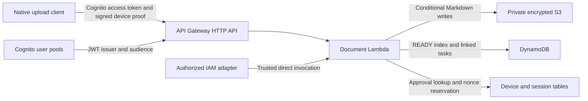

# Markdown file-sharing network across agents

An AWS storage and API foundation for agents that need to share durable Markdown across tools and sessions. A local file or a successful HTTP request alone does not establish that another agent can retrieve the intended document. This service binds uploads to an authenticated owner, stores Markdown in S3, and publishes a DynamoDB index with explicit per-file receipts.

This repository contains the infrastructure and document Lambda extracted from [GB Systems and Agents](https://github.com/gopalcb/gb-systems-and-agents). The [companion Markdown MCP service](https://github.com/gopalcb/markdown-mcp-service) supplies a separate MCP interface. No MCP server, web frontend, portal backend application, watcher, production data, or source Git history is included here.



## Request, authentication, and storage

`POST /documents` and `POST /browser-documents` use separate Cognito JWT authorizers with explicit audiences. Lambda checks access-token ownership, original session age, signed native device proofs, administrator approval, and replay nonces before ingestion. Device IDs and MAC addresses are reported metadata, not hardware attestation. The optional native client uses macOS Keychain and a Swift signing helper; the offline quickstart does not require a Mac login.

IAM-authorized direct Lambda invocations support document reads, conditional edits, folders, linked plan tasks, and a project catalog. Their `username` is trusted input supplied by the authorized caller. Keep Lambda invoke permission narrowly scoped and have an adapter verify the human identity before constructing these events. The public HTTP routes reject direct-operation dispatch. No browser application or session-cookie backend is provided here.

Group uploads use `agent-work/raw-markdown/<username>/<file-group>/<filename>.md`. Project-path uploads use `agent-work/raw-markdown/<username>/<canonical-relative-path>` with no inserted file-group segment: `docs/projects/demo/notes.md` becomes `<username>/projects/demo/notes.md`. They strip one leading `docs/`, preserve nested paths, and derive a stable UUID5 from owner and canonical path. S3 uses conditional writes and source binding to detect collisions; DynamoDB publishes the compact `READY` index afterward. Linked plan tasks preserve independent task edits on source updates. Deletion reports record observations; they do not delete stored documents.

A successful receipt requires `status: READY` and a nonempty `file_id`. HTTP 201 means all files succeeded; 207 contains mixed per-file outcomes. S3 and DynamoDB are separate writes: an index failure can leave stored bytes without a published record, so an incomplete or uncertain result requires inspection before retry. Current reads return latest bytes and an ETag. Receipts do **not** pin an immutable S3 version. Browser-style edits require the expected ETag to avoid overwriting a concurrent edit.

## Run locally without AWS

Use Python 3.13, matching the Lambda runtime:

```sh
python3.13 -m venv .venv
. .venv/bin/activate
python -m pip install -r requirements-dev.txt
AWS_EC2_METADATA_DISABLED=true AWS_DEFAULT_REGION=ca-central-1 \
  AWS_ACCESS_KEY_ID=testing AWS_SECRET_ACCESS_KEY=testing python -m pytest -q
cfn-lint aws-infrastructure/*.yaml aws-infrastructure/document-api/template.yaml
python scripts/local_smoke.py
```

The smoke script runs the real handler inside Moto, uploads fixture Markdown through the trusted direct-invocation boundary, reads it back, and verifies stable identity on repeat upload. It prints `offline-moto`, upload 201, read 200, `READY`, and `stable_file_id: true`. Its temporary resources disappear when the process exits. Tests cover JWT ownership, replay/device approval, payload validation, storage paths, IAM policy boundaries, conflict handling, linked tasks, reads, and sanitization. These checks do not prove real Cognito login, private device enrollment, live IAM behavior, or deployed AWS acceptance.

## Infrastructure and packaging

- `aws-infrastructure/document-api/template.yaml`: HTTP API, Lambda, retained S3 buckets, document/project/deletion tables, and native device registries.
- `aws-infrastructure/auth.yaml`: public upload client attached to an existing pool, plus the retained session/device binding table.
- `aws-infrastructure/username-auth.yaml`: optional retained username pool, hosted-login domain, and a separate upload client. Set `DomainPrefix`; `EmailSourceArn` is an explicit SES identity parameter; enabling email OTP additionally needs a verified sender and a compatible pool tier/region.
- `aws-infrastructure/document-api/iam/`: example separated runtime, provisioner, deployer, and explicit device-approval policy documents.

Cloud deployment is deliberately not automated. GitHub Actions only installs dependencies, runs tests, lints templates, and runs the offline smoke. It has `contents: read`, no OIDC permission, and no deployment job.

Before any separately authorized deployment, provision and review the role trust/policies for your account, replace the fictitious `123456789012` account and example pool/client values in IAM/helper examples, and review the retained resource names and region. The source-compatible `softrobots-*` names remain because runtime tables and policy scopes share those names; use an isolated account or review collisions before provisioning. Configure both authorizer pool/client pairs explicitly from your Cognito stacks; the optional username stack supplies one pair. `auth.yaml` attaches to an existing pool and does not enable OTP on that pool itself.

Package the **entire** `aws-infrastructure/document-api/src/` directory, including `session_device_service.py`, plus its installed requirements into the Lambda zip root (`app.py` at root). No package builder is shipped. Build native dependencies in a Linux environment compatible with Python 3.13 and the Lambda architecture. Supply `ArtifactBucket` and `ArtifactKey` to the API template through your own reviewed delivery process. The templates use a pre-existing `softrobots-document-api-lambda-role`; creating that role is an explicit prerequisite.

Scripts for artifact preparation, IAM policy configuration, auth discovery, and device approval are retained as tested **reference helpers**. Their example account/role/repository guards require deliberate customization; the workflows they mention from the original system are not shipped. They may mutate AWS when explicitly invoked with real credentials. None runs during local validation or CI. `scripts/upload.py` defaults to `example.invalid`; a real upload requires an explicit `--upload-url`, human authentication, and approved native device setup.

## Limits and operational ownership

Markdown content is bounded to 256 KiB per file. Pagination is bounded and identity-bound. Storage is private, encrypted, and retained on stack deletion; current bucket versioning is suspended, and any historical versions survive. Retained storage, DynamoDB, Lambda, API Gateway, logs, Cognito, and optional SES can incur charges. Removing a stack does not remove retained data: use a separately reviewed retention/cleanup procedure.

The MCP service is independently deployed and has its own authentication, dependencies, and receipt contract. Do not assume that using that companion service invokes this Lambda's linked-task workflow. This extraction provides local evidence only and does not deploy, alter, or validate any production system.

See [ARCHITECTURE.md](ARCHITECTURE.md), [code-map.yaml](code-map.yaml), and [PROVENANCE.md](PROVENANCE.md) for boundaries and extraction details. Licensed under [MIT](LICENSE).
