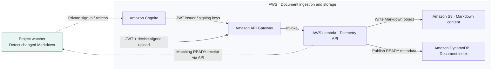
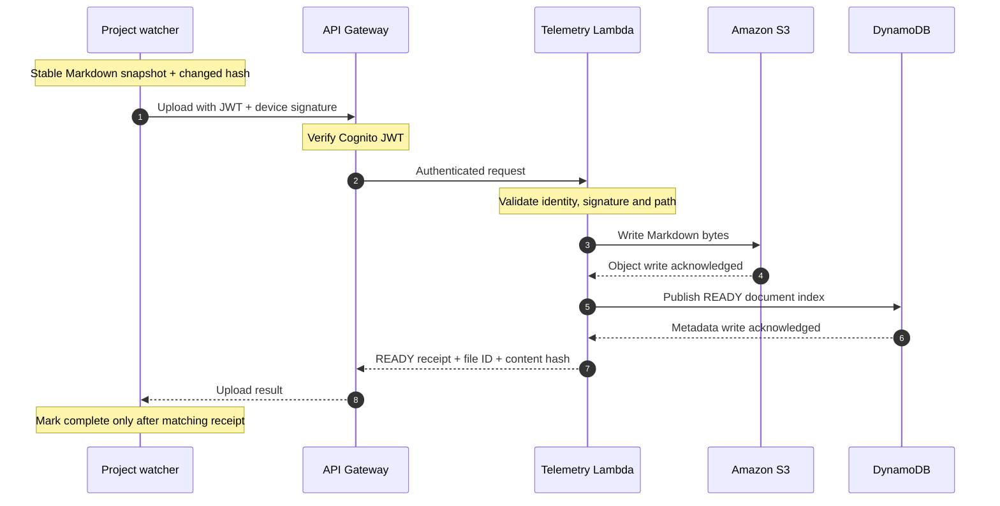
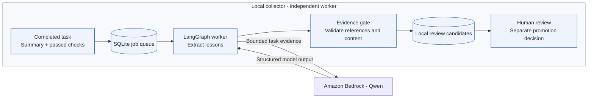
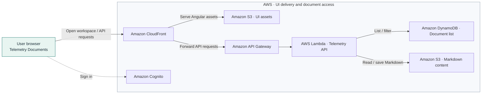

# Markdown file-sharing network across agents

Keep project documents in reach as people and agents work. Share changed Markdown, collect useful lessons from completed tasks, and give users one place to read shared documents.

## From the watcher to AWS file storage

Watcher → API Gateway → Lambda → S3 content and DynamoDB index. Dashed arrows show authentication and the upload acknowledgement. This is the repository’s example architecture, not a live deployment claim.



- **Share documents:** a configured watcher scans project folders and uploads new or changed Markdown.

- **Capture lessons:** the strategic memory collector turns verified task evidence into candidates for review.

- **Read in one place:** Telemetry brings shared documents into a searchable document list and reader.

- **Support agent workflows:** authenticated MCP uploads use the same document storage as the UI and native uploader.

## The watcher follows Markdown changes

- Scans the configured project recursively for `.md` files, with watcher runtime folders excluded.

- Waits for a stable snapshot and compares content hashes to skip unchanged documents.

- Uploads through an authenticated, signed request; project-relative paths preserve document identity.

- Confirms the matching `READY` receipt before marking an upload complete.

- Keeps unknown write outcomes marked for reconciliation before another upload attempt.

The watcher records success only after the exact READY receipt returns. If the outcome is unknown, reconcile before retrying.



The watcher covers Markdown document changes, not every source-code edit. Its copied local files require verified project and identity binding before startup. The watcher implementation and its private runtime state remain local and are excluded from this public repository.

## The strategic memory collector prepares lessons for review

- Accepts a completion manifest after required verification and the final task summary.

- Queues the job in SQLite and runs model work in a detached, one-shot worker.

- Uses LangGraph and a Bedrock Qwen adapter to extract reusable lessons.

- Checks passed-evidence references and rejects sensitive, temporary, unrelated or duplicate output.

- Stores review-only candidates locally; a separately authorized workflow decides what becomes trusted memory.

Only the extraction call uses Bedrock. The queue and candidates remain local; no automatic promotion or Telemetry publication is installed.



The collector is implemented as an independent local package. Parent completion hooks are not installed, promotion is never automatic, and candidates are not currently published into Telemetry Documents.

## Telemetry is the shared reading desk

- Sign in to a configured Telemetry instance and open **Workspace → Documents**.

- Use category filters or **My documents**; search the loaded list and use **Load more** for additional pages.

- Select a document to open its Markdown in the reader/editor.

- Save eligible owned documents with a version check; other edits save as a copy in your folder.

- Use **Upload** to add Markdown directly through the UI.

CloudFront serves the Angular UI from its own S3 bucket and forwards API requests. Document content lives in a separate S3 bucket; DynamoDB supplies its index. Responses return along the request path.



The UI and API are present in this checkout. This guide describes their source behavior; it does not establish a live deployment or a working private sign-in session.

## Source notes

Based on current local documentation and implementation inspected on 02 November 2026. No watcher, upload, cloud inference or live application check was run for this guide.

- [Architecture](ARCHITECTURE.md) — runtime and storage responsibilities

- [Collector guide](strategic-memory-collector-agent/README.md) — queue, status and review

- [Collector architecture](strategic-memory-collector-agent/ARCHITECTURE.md) — extraction and evidence gates

- [Documents component](telemetry-ui/src/app/components/documents/documents.component.ts) — search, filters and saves

Diagram syntax: [Mermaid flowcharts](https://mermaid.js.org/syntax/flowchart.html). AWS service artwork: [AWS Architecture Icons](https://aws.amazon.com/architecture/icons/), embedded from [AWS Labs icon library v20.0](https://github.com/awslabs/aws-icons-for-plantuml/tree/v20.0). GitHub renders the Mermaid diagrams in this README. The [HTML overview](project-overview.html) includes embedded diagrams and AWS artwork for offline viewing.

Explore next: **receipt reconciliation** to understand uncertain uploads; **candidate review** to decide which lessons deserve promotion. If a job is queued, is memory already trusted? No — collection and review still follow.

### Key takeaways

- The watcher keeps changed Markdown moving toward shared storage.

- The collector prepares evidence-backed lessons for review.

- Telemetry gives users one place to find and read shared documents.

## Repository layout and validation

The current application uses one compact Flask/FastMCP runtime in
`telemetry-api/`, an Angular UI in `telemetry-ui/`, and CDK/templates in
`aws-infrastructure/`. Document persistence lives in two services:
`dynamodb_document_service.py` and `s3_document_service.py`.

The older standalone `aws-infrastructure/document-api/` extraction has been
removed. Do not restore it alongside the current runtime. Future application work
belongs here; the Softrobots copy remains historical deployment context.

`strategic-memory-collector-agent/` is a separate local LangGraph worker using
Bedrock Qwen. It queues completed task evidence and stores reviewable candidates.
Its tests use a fake model; parent completion hooks and automatic promotion are
not installed.

## Local validation

Use Python 3.13 and Node 22.13 or later:

```sh
uv venv --python 3.13 .venv
uv pip install --python .venv/bin/python -r requirements-dev.txt
AWS_EC2_METADATA_DISABLED=true AWS_DEFAULT_REGION=ca-central-1 \
AWS_ACCESS_KEY_ID=testing AWS_SECRET_ACCESS_KEY=testing \
.venv/bin/python -m pytest -q
.venv/bin/ruff check telemetry-api aws-infrastructure/cdk tests
.venv/bin/cfn-lint aws-infrastructure/*.yaml
npm ci
npm run build
npm test
uv sync --project strategic-memory-collector-agent --locked
(cd strategic-memory-collector-agent && uv run --locked pytest -q && uv run --locked ruff check .)
```

Run collector lint from its folder with `uv run --locked ruff check .`.
The root npm workspace/lockfile and `.npmrc` provide reproducible UI installation.
The compact runtime suite and CDK suite run together by default; the collector
has its own package environment.

For synthetic browser checks, install Chromium with
`npx playwright install chromium`, then run
`WO_BROWSER_EVIDENCE=/tmp/markdown-browser npm run test:browser`.
On macOS the harness uses installed Chrome by default; override
`WO_BROWSER_EXECUTABLE` if needed. Fixtures do not prove private authentication.

## Storage and release boundary

The API, UI sessions and MCP use the same document storage implementation.
Owner/path identity and conditional writes preserve linked tasks; successful
uploads require READY receipts. Unknown write outcomes require reconciliation.
The collector's local candidates are separate from these document records.

CI validates runtime/CDK, collector and UI independently with read-only repository
permissions. No deployment, AWS credential action, IAM policy updater, retirement,
or production cutover helper is supplied. CDK synthesis uses fictitious account
123456789012 and example identities; real-account synthesis is rejected.
A live deployment needs explicit ownership/configuration and separate authorization.

Copied watcher/device/session/delivery files remain ignored local state.
Do not publish them or start them without checking their identity/project binding.
See [architecture](ARCHITECTURE.md), [code map](code-map.yaml), and
[provenance](PROVENANCE.md).
